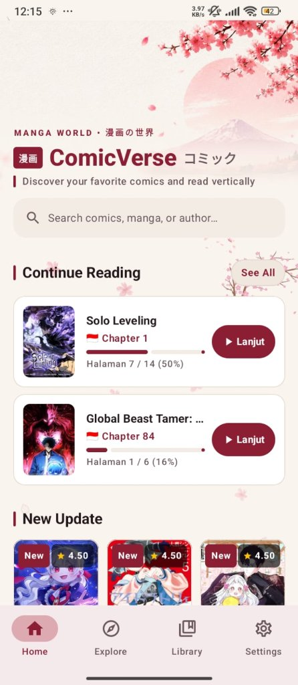
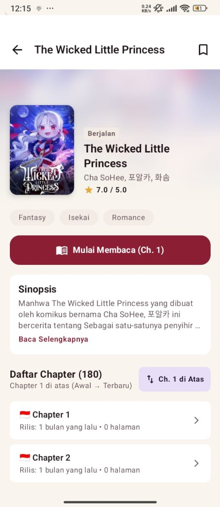
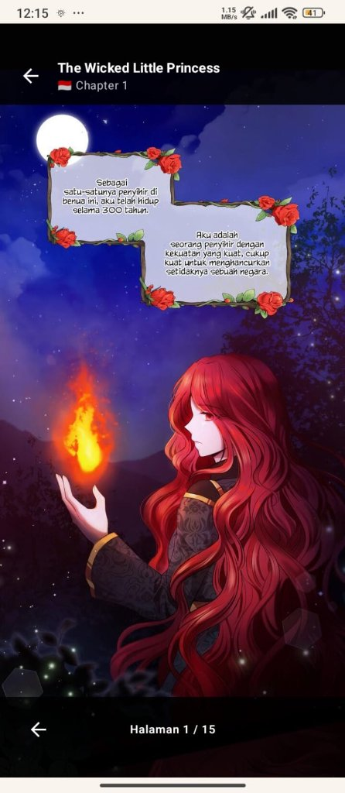
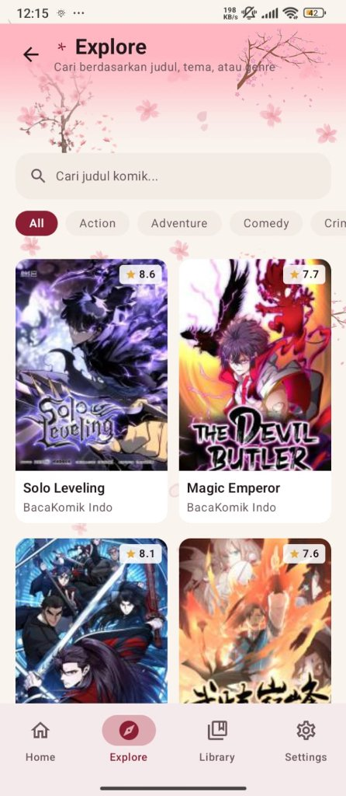
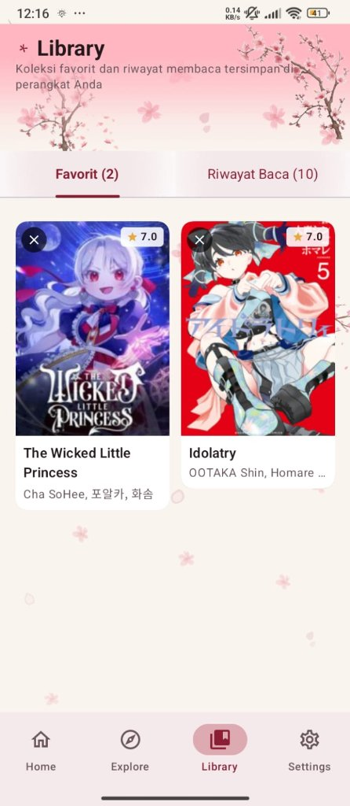
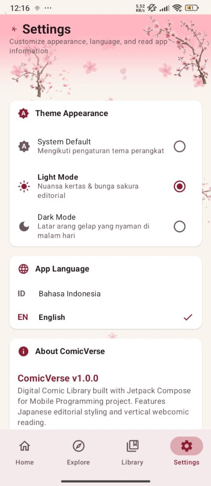

# 🌸 ComicVerse (コミック) — Modern Digital Comic & Webtoon Reader for Android

<p align="center">
  
  &nbsp;&nbsp;&nbsp;&nbsp;
  
  &nbsp;&nbsp;&nbsp;&nbsp;
  
</p>

<p align="center">
  <b>ComicVerse</b> adalah aplikasi pembaca komik digital dan webtoon berbasis <b>Android</b> yang dibangun secara native menggunakan <b>Jetpack Compose</b> dengan estetika desain <i>Japanese Editorial & Sakura Wabi-Sabi</i>. Dirancang khusus untuk memberikan pengalaman membaca komik berbahasa Indonesia yang cepat, lancar, dan nyaman di perangkat mobile.
</p>

<p align="center">
  
  
  
  
  
  
</p>

---

## 📸 Antarmuka Aplikasi (Screenshots)

| Beranda (Home) | Eksplorasi (Explore) | Detail Komik |
| :---: | :---: | :---: |
|  |  |  |
| *Kartu Lanjut Membaca, Progress Bar, & Komik Terbaru* | *Filter 35+ Genre, Pencarian Instan, & Grid Katalog* | *Header Backdrop Blur, Urutan Chapter (Ch. 1 / Terbaru)* |

| Mode Pembaca (Reader) | Koleksi (Library) | Pengaturan (Settings) |
| :---: | :---: | :---: |
|  |  |  |
| *Vertical Continuous Webtoon Scroll & Indikator Halaman* | *Daftar Favorit dengan Tombol Hapus (✕) & Riwayat Baca* | *Tema Gelap / Terang Sakura & Pilihan Bahasa ID / EN* |

---

## ✨ Fitur Unggulan

### 1. 🔄 Sistem Reload Mirip Google Chrome Mobile (Pull-to-Refresh)
- Tersedia pada seluruh halaman utama (**Home, Explore, Detail Komik, Rankings, dan Library**).
- Pengguna cukup menggeser layar ke bawah (*swipe down*), indikator refresh bundar melayang (*floating progress circle*) akan muncul di bagian atas layar mirip seperti Google Chrome mobile dan memuat ulang data terbaru secara instan.

### 2. 📖 Smart Continue Reading & Pelacak Progres Baca
- Jika pengguna telah mulai membaca suatu komik, tombol di detail komik berubah otomatis menjadi **"Lanjut Membaca"**.
- Di halaman utama (Home), muncul kartu **Continue Reading** yang mencantumkan:
  - Nomor Chapter yang sedang dibaca.
  - Posisi halaman aktif dan total halaman (contoh: *Halaman 7 / 14*).
  - Persentase penyelesaian chapter dalam bentuk teks persentase (*50%*) dan **Linear Progress Bar**.

### 3. 🔍 Eksplorasi Luas & Filter 35+ Genre
- Mendukung lebih dari 35 pilihan genre (Action, Romance, Isekai, Fantasy, Slice of Life, Sci-Fi, Shounen, Seinen, Supernatural, Comedy, Drama, Mystery, Horror, Martial Arts, dsb).
- Pencarian judul atau pengarang secara responsif (*live search filtering*).
- Menampilkan katalog khusus **Manga Tamat (Completed Manga)** dengan koleksi lengkap terverifikasi.

### 4. 📑 Detail Komik Lengkap & Pengurutan Chapter
- Header poster beresolusi tinggi dengan efek *dynamic blurred backdrop* di latar belakang.
- Penyesuaian urutan daftar chapter:
  - **Ch. 1 di Atas (Awal → Terbaru)**: Memudahkan pembaca baru mulai dari awal cerita tanpa harus *scroll* ke bawah.
  - **Terbaru di Atas (Terbaru → Awal)**: Memudahkan pembaca setia langsung melihat rilisan chapter teranyar.
- Ringkasan sinopsis komik dengan opsi *Baca Selengkapnya*.

### 5. 📱 Seamless Webtoon Vertical Reader
- Membaca komik secara vertikal bebas jeda (*continuous vertical scroll*).
- Indikator halaman mengambang di bawah (*Floating Page Counter* e.g. "Halaman 1 / 15").
- Dukungan *zoom/pan* halus serta pengelolaan memori gambar dengan caching Coil.

### 6. 📚 Manajemen Koleksi Lokal (Library)
- Simpan komik favorit dengan satu ketukan ikon bookmark.
- Fitur penghapusan komik dari favorit langsung dari halaman Library menggunakan tombol badge `✕` yang intuitif.
- Tab **Riwayat Baca** yang mencatat komik-komik yang baru saja dibaca secara offline menggunakan database Room.

### 7. 🎨 Japanese Editorial Design & Personalisasi
- Nuansa tema terinspirasi dari estetika kertas washi dan kelopak bunga sakura Jepang (*Soft Rose, Cream Papyrus, & Deep Crimson*).
- Pilihan **Light Mode**, **Dark Mode (Latar arang gelap)**, atau **System Default**.
- Pilihan Bahasa Antarmuka: **Bahasa Indonesia (ID)** & **English (EN)**.

---

## 🌐 Sumber Data & API Architecture

Aplikasi ComicVerse menggunakan integrasi API Komik Berbahasa Indonesia yang andal dan tidak terkena blokir internet positif/DNS:

### 1. Sanka Vollerei Comic API (BacaKomik ID)
- **Base Endpoint:** `https://www.sankavollerei.web.id/`
- **Tipe Komik:** Manga, Manhwa, Manhua dengan terjemahan Bahasa Indonesia.
- **Daftar Endpoint Utama:**
  - `GET /comic/popular` & `GET /comic/recommended` — Mengambil rilisan populer dan komik mingguan.
  - `GET /comic/newest` — Mengambil pembaruan chapter komik terbaru (*New Update*).
  - `GET /comic/completed` — Menampilkan komik yang telah tamat (*Completed Manga*).
  - `GET /comic/search?q={query}` — Pencarian komik berdasarkan kata kunci judul.
  - `GET /comic/genres` & `GET /comic/genres/{genre}` — Mengambil daftar dan filter komik berdasarkan genre.
  - `GET /comic/detail/{endpoint}` — Detail komik lengkap, sinopsis, skor, status, dan daftar chapter.
  - `GET /comic/chapter/{endpoint}` — Daftar URL gambar panel komik untuk mode pembaca (*Reader*).

### 2. Legal Creative Commons Offline Fallback
- Ketika perangkat pengguna kehilangan koneksi internet atau server sedang mengalami pemeliharaan, aplikasi memiliki sistem cadangan otomatis (**LegalDemoComicProvider**).
- Fallback menggunakan komik open-source berlisensi *Creative Commons Attribution 4.0* (*Pepper & Carrot* oleh David Revoy), sehingga aplikasi tetap dapat dijelajahi dan dibaca tanpa mengalami *force close* atau layar kosong.

---

## 🏛️ Arsitektur & Teknologi

ComicVerse dibangun dengan standar pengembangan Android modern:

```
app/
├── data/
│   ├── local/              # Room Database, DAO (ComicDao, HistoryDao), Entities
│   ├── model/              # Domain Model & DTOs (SankaComicDto, ChapterImageDto, dll)
│   ├── remote/             # Retrofit API Service, OkHttp Client, LegalDemoComicProvider
│   └── repository/         # ComicRepositoryImpl (Single Source of Truth)
├── ui/
│   ├── components/         # Reusable UI (ComicCard, PullToRefreshWrapper, JapaneseHeader)
│   ├── detail/             # DetailScreen, DetailViewModel
│   ├── explore/            # ExploreScreen, ExploreViewModel
│   ├── home/               # HomeScreen, HomeViewModel
│   ├── library/            # LibraryScreen, LibraryViewModel
│   ├── reader/             # ReaderScreen, ReaderViewModel
│   ├── settings/           # SettingsScreen, SettingsViewModel
│   └── theme/              # Color, Type, Shape, Theme (Sakura Editorial Theme)
└── utils/                  # Network monitor, String helpers, Image sanitizers
```

### Tech Stack:
- **Language:** Kotlin 2.0.21
- **UI Framework:** Jetpack Compose & Material 3
- **Design Pattern:** MVVM (Model-View-ViewModel) + Repository Pattern
- **Reactive Streams:** Kotlin Coroutines & StateFlow / SharedFlow
- **Networking:** Retrofit 2.11.0, OkHttp 4.12.0, Gson Converter
- **Local Persistence:** Room Database 2.6.1 & Android DataStore Preferences
- **Image Loading:** Coil 2.7.0 (dengan disk cache, memory cache, dan custom OkHttp header)
- **Navigation:** Navigation Compose 2.8.3

---

## 🚀 Panduan Instalasi & Menjalankan Proyek

### Prasyarat:
1. **Android Studio:** Android Studio Koala / Ladybug atau versi lebih baru.
2. **JDK:** Java Development Kit versi 17 atau 21.
3. **Android Device / Emulator:** Minimal Android 8.0 (API Level 26) ke atas.

### Langkah-langkah:
1. Clone repositori ini ke komputer lokal Anda:
   ```bash
   git clone https://github.com/Aziz140609/ComicVerse.git
   cd ComicVerse
   ```
2. Buka proyek melalui Android Studio (`File` -> `Open` -> Pilih folder `ComicVerse`).
3. Tunggu hingga proses **Gradle Sync** selesai mengunduh dependensi.
4. Buat file APK debug melalui terminal atau menu Android Studio:
   ```bash
   ./gradlew assembleDebug
   ```
5. Pasang ke perangkat fisik atau emulator Android:
   ```bash
   ./gradlew installDebug
   ```

---

## 📄 Lisensi & Hak Cipta
- Hak cipta konten komik dan karya manga merupakan milik masing-masing penerbit, mangaka, dan tim scanlation terkait.
- Fallback komik bersumber dari *Pepper & Carrot* karya David Revoy dengan lisensi [Creative Commons Attribution 4.0](https://creativecommons.org/licenses/by/4.0/).
- Kode sumber aplikasi ComicVerse dikembangkan di bawah lisensi terbuka [MIT License](LICENSE).
